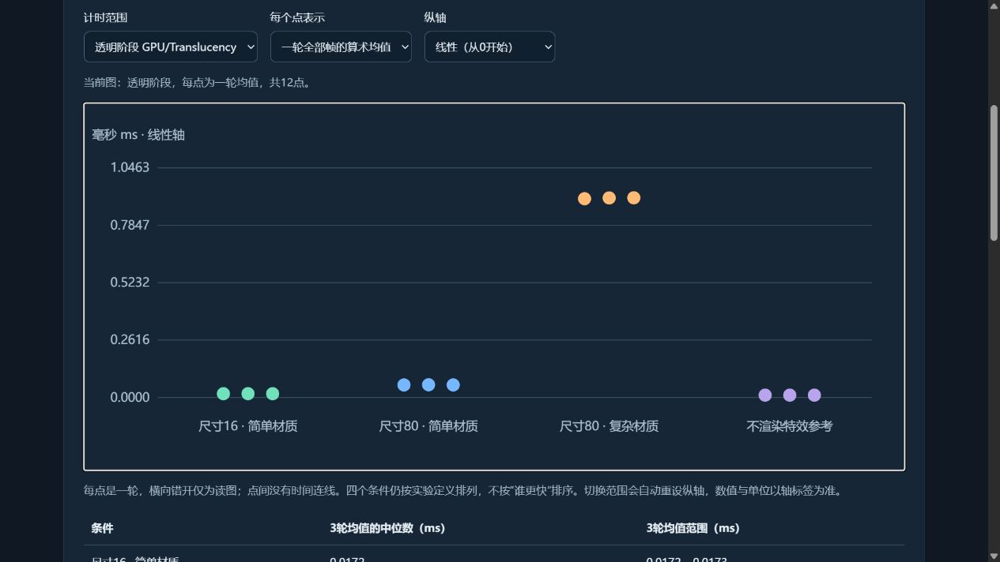

# TA05 · Niagara GPU Timing Companion

**77的技术美术实战｜把 UE 制作中的问题、工具与流程讲清楚。**

An offline, interactive teaching companion for reading **existing Unreal Engine Niagara rendering measurements**. It contains 12 measured windows and 40,353 sampled frames. This is a data-reading example, not a new benchmark, optimisation tool, Unreal plugin, or game.

**[Open the interactive companion / 直接打开交互伴读](https://qiqideqi.github.io/ta05-niagara-gpu-timing-companion/)**

## Choose a task / 按任务开始

- **Niagara profiling / 排查 Niagara 性能** — Start with the TA05 chart and [reading exercise](https://qiqideqi.github.io/ta05-niagara-gpu-timing-companion/#reading-exercise). Compare a render-pass result with whole-frame GPU time and say what each measurement supports.
- **Editor tools / 做 UE 批量工具** — Start with the [UE02 rename preview exercise](https://qiqideqi.github.io/ta05-niagara-gpu-timing-companion/ue02-rename-preview-en.html) ([中文](https://qiqideqi.github.io/ta05-niagara-gpu-timing-companion/ue02-rename-preview.html)). Change a naming rule after previewing and check whether the stale preview can still run.
- **Cutscene handoff / 梳理过场审核交接** — Open the [handoff exercise](https://qiqideqi.github.io/ta05-niagara-gpu-timing-companion/cutscene-handoff-exercise-en.html) ([中文](https://qiqideqi.github.io/ta05-niagara-gpu-timing-companion/cutscene-handoff-exercise.html)). Write a note another teammate can use to identify the shot, version and time range.

## English measurement guide

Read the **[standalone illustrated guide](https://qiqideqi.github.io/ta05-niagara-gpu-timing-companion/measurement-notes.html)** for metric scopes, all 12 windows, window means versus sample maxima, and an eight-frame worked excerpt. It includes three figures and the measurement limits; no Chinese tutorial or Unreal installation is required to follow it. The existing interactive charts remain available above. Try the [English reading exercise](https://qiqideqi.github.io/ta05-niagara-gpu-timing-companion/measurement-notes.html#reading-exercise-en) to compare render-pass and whole-frame readings.

## Start / 开始使用

**[Try the online reading exercise / 直接做读数练习](https://qiqideqi.github.io/ta05-niagara-gpu-timing-companion/#reading-exercise)**

Choose one size or material comparison. Record the changed variable, timing scope, selected windows and measured values, then write what the readings support. You can do this in your browser without opening Unreal Engine.

选一组尺寸或材质对照，记下变量、计时口径、窗口和读数，再写一句结论。完成后可用[反馈模板](https://github.com/QIQIdeqi/ta05-niagara-gpu-timing-companion/issues/new?template=reproduction.md)记录结论或卡点。离线用法如下。

1. Download and extract the **[latest offline ZIP](https://github.com/QIQIdeqi/ta05-niagara-gpu-timing-companion/releases/latest)**. Open `index.html` or `measurement-notes.html` directly from the extracted folder.
2. Open `index.html` in a modern browser. The page is in Chinese; all chart data is embedded. No account, network, Unreal installation, CDN, or build step is required.
3. Switch **透明阶段** (GPU/Translucency) versus **整帧 GPU** (GPUTime), **均值** (mean) versus **采样最大值** (sample maximum), and linear versus logarithmic axes.
4. Choose a measured window and click **定位所选范围的首个采样最大值** to locate its first sampled maximum. The slider inspects individual sampled frames.
5. The two buttons at the bottom export the original per-window and per-frame CSV files, byte for byte. Narrow screens can scroll the charts horizontally.

完整免费方法及节点搭建说明见作者原教程：[Niagara性能排查：粒子数、Overdraw与GPU计时｜TA实践手记05](https://zhuanlan.zhihu.com/p/2097710842536113511)。本仓库独立提供图表、数据、条件和操作步骤，不以外跳或付费作为使用条件。

## What the comparison means / 怎样读对照

- A: sprite size 16 versus 80, with the same simple material.
- B: keep size 80 and the opacity outline fixed, then change material work.
- Reference: hide the effect's rendering; the background still has a cost.
- Each condition has three interleaved measured windows. A chart point represents one window, not an independent machine or an additional experiment.
- GPU/Translucency is a scene pass measurement, not one Niagara resource's exclusive GPU time. GPUTime covers the whole frame. Stage differences cannot be translated directly into a fixed FPS improvement.

图表、表格和逐帧读数分别保留统计口径。峰值是已采样窗口的最大值，不冒充完整技能生命周期峰值；三轮范围不是置信区间。Overdraw调试颜色没有换算为毫秒。

## Frozen measurement conditions / 真实采集条件

Windows · UE5.8.2 · D3D11/SM5 · RTX 4070 Laptop GPU · driver 560.94 · 1280×720 · FOV 50 · seed 77. CPU simulation advances 60 × 1/60 seconds and then pauses; GPU rendering continues. Each window has 5 seconds of warm-up and approximately 10 seconds of timing; three interleaved repetitions per condition. The three rendered cases recorded 88 active particles.

These are static rendering comparisons at approximately one second of system age. They do not establish GPU particle simulation cost, dynamic gameplay cost, exclusive hardware conditions, cross-machine behaviour, or a universal resource ranking.

## Files and verification

- `index.html`: single-file interactive reader, version 1.0.2, including the two original CSV exports; now with an optional English-guide link.
- `measurement-notes.html` and `docs/measurement/`: standalone English explanation with three checked figures; original measurements are unchanged.
- `data/逐轮统计.csv`: 12 window summaries.
- `data/逐帧关键列.csv`: all 40,353 key-frame rows.
- `data/实测汇总.json`: original measured summary.
- `data/provenance.json`: hashes, source scope and statistical limitations.
- `verify_readings.py`: recomputes the window means and sampled maxima from the two public CSVs.

### Recompute the readings / 自行复算读数

Download the [verified offline ZIP v1.0.5](https://github.com/QIQIdeqi/ta05-niagara-gpu-timing-companion/releases/download/v1.0.5/TA05-Niagara-GPU-Timing-Companion-v1.0.5.zip) or clone this repository, then run `python verify_readings.py` from the extracted repository folder. Python 3.8 or later is sufficient. The script checks the two CSV hashes and sample counts, then prints the arithmetic mean, sampled maximum and first frame index reaching that maximum for each metric in each window. All timings are in milliseconds and frame indices start at zero. Expect `PASS: 12 windows, 40353 sampled frames`. For example, in window `01 A_large`, the whole-frame and translucency maxima occur at frames 3139 and 3148, respectively.

解压[离线 ZIP v1.0.5](https://github.com/QIQIdeqi/ta05-niagara-gpu-timing-companion/releases/download/v1.0.5/TA05-Niagara-GPU-Timing-Companion-v1.0.5.zip) 或克隆仓库，在含复算脚本的文件夹运行 `python verify_readings.py`。对照输出中的两个峰值帧，检查整帧 GPU 和透明阶段的采样最大值是否出现在同一帧。脚本复算的是公开 CSV 中已有的 12 个窗口。

The original 12 CSV hashes were checked against frozen records. Means and sample maxima were recomputed from all key frames. Browser checks covered eight chart combinations, 24 peak-location cases and a 390px responsive viewport; the original CSV export bytes were checked. This does not establish an independent reader reproduction or a physical-phone test.

## Next reading exercise / 下一道读数练习

[打开逐轮比较 / Open the interactive six-window exercise](https://qiqideqi.github.io/ta05-niagara-gpu-timing-companion/ta10-six-window-exercise.html)

**TA10 · UE5.8.4 · E3 CPU and E4 GPU.** The two single-system configurations use 32,768 particles and sprite size 8. The six windows below were recorded in a shared environment. Each cell shows a window mean in milliseconds.

两组均为单系统、32,768 粒子、Sprite 尺寸 8。以下六窗来自共享环境，单位为毫秒，每格是一个窗口的均值。

| Round / 轮次 | E3 CPU FrameTime | E4 GPU FrameTime | E3 CPU GPU/Translucency |
| --- | ---: | ---: | ---: |
| 1 | 4.712 | 3.161 | 0.209 |
| 2 | 6.547 | 7.615 | 0.373 |
| 3 | 3.386 | 3.315 | 0.191 |

1. Which configuration has the lower frame time in each round? Compare that with the two medians of the three window means. / 逐轮比较谁的帧时更低，再看两组各自三窗均值的中位数。
2. E3 has no observed GPU simulation reading in these windows. What can its translucency readings establish? / E3 没有取得 GPU 模拟计时，这三项透明阶段读数能说明什么？

Check your reading / 核对答案

E4 has the lower mean in rounds 1 and 3. E3 has the lower mean in round 2. The medians of the three window means are 4.712 ms for E3 and 3.315 ms for E4. This describes the measured windows. A causal ranking requires a controlled follow-up.

E4 在第 1、3 轮帧时更低，E3 在第 2 轮更低。三窗均值的中位数是 E3 4.712 ms、E4 3.315 ms。要判断换位是否来自模拟目标，需要另做控制后台负载的对照。

Record E3 GPU simulation as **not observed**. The translucency values show that the scene's GPU pass still reports time with CPU simulation. They do not measure the exclusive GPU cost of one Niagara system.

E3 的 GPU 模拟计时记为「未观测」。CPU 模拟条件下，场景透明阶段仍有 GPU 读数。这个范围覆盖场景 Pass，不能归为一个 Niagara 系统的独占耗时。

See section 07 and the reading exercise in the [free TA10 Chinese tutorial](https://zhuanlan.zhihu.com/p/2100010070838883685) for the original comparison, capture conditions and follow-up checks.

## Questions and reproduction / 疑问与复现反馈

If a chart, CSV export or explanation does not match what you expected, [open a focused issue](https://github.com/QIQIdeqi/ta05-niagara-gpu-timing-companion/issues/new?template=reproduction.md). State the step you reached, expected versus observed behaviour, selected metric/window/frame, and the relevant environment. Reading without running UE is welcome; mark it as reading rather than a reproduction.

有疑问可使用[复现反馈模板](https://github.com/QIQIdeqi/ta05-niagara-gpu-timing-companion/issues/new?template=reproduction.md)，留下最短步骤和实际差异。不要求上传整个工程；未知值保留未知，原CSV不要覆盖。自己的UE测试属于另一次实验，需单独记录条件，不能与这里的静态渲染数据混算。请先移除账号、令牌、私有路径与未获准公开的素材。

## Attribution and scope

Created for **77的技术美术实战**. AI assisted with code, wording and layout; numerical claims are grounded in the recorded CSV data and checks. No Unreal Engine binaries, third-party UE assets, private project files or paid Knowledge Planet packages are included. This repository does not change the original teaching project's licence; see [RIGHTS.md](RIGHTS.md).

Technical background: Epic Games, *Measuring Performance in Niagara* and *Viewport Modes*. This is an independent teaching resource, not an Epic Games product or endorsement.

## TA15 · 缓存切入逐帧练习

从计时转到画面差异。比较第 56 和 57 帧的两种回放模式，解释为什么需要对齐输出帧号并连续查看。 [打开逐帧练习](https://qiqideqi.github.io/ta05-niagara-gpu-timing-companion/ta15-cache-cut-exercise.html)

先用逐帧图解比较第 56、57 帧，再用第 56 帧的三个原始 PNG 复算掩膜差。需要重搭时，从免费手册进入。
[中文搭建手册](https://qiqideqi.github.io/ta05-niagara-gpu-timing-companion/ta15-mrq-setup.html) · [中文原图复算](https://qiqideqi.github.io/ta05-niagara-gpu-timing-companion/ta15-frame56-samples/#recompute-mask)

Compare output frames 56 and 57, then use three original PNGs to recompute the frame 56 mask differences.
[English frame exercise](https://qiqideqi.github.io/ta05-niagara-gpu-timing-companion/ta15-cache-cut-exercise-en.html#check) · [English setup guide](https://qiqideqi.github.io/ta05-niagara-gpu-timing-companion/ta15-mrq-setup-en.html) · [English PNG exercise](https://qiqideqi.github.io/ta05-niagara-gpu-timing-companion/ta15-frame56-samples/en.html#recompute-mask)

离线使用 / [TA15 bilingual offline bundle v1.5](https://qiqideqi.github.io/ta05-niagara-gpu-timing-companion/ta15-offline-companion-zh-en-v1.5.zip)
